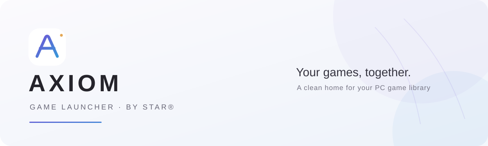

  

  

  <strong>Your games, together.</strong> 
  A calmer home for your PC game library.

<strong>⚠ BETA PROGRAM</strong> · Axiom is in active development; features and behavior may change.

  <a href="https://github.com/RadtALIVE/axiom-launcher/releases/download/v0.3.4/Axiom-Setup-0.3.4-x64.exe"><strong>Download the beta for Windows</strong></a>
  &nbsp; · &nbsp;
  <a href="https://github.com/RadtALIVE/axiom-launcher/releases/tag/v0.3.4">Release notes</a>
  &nbsp; · &nbsp;
  <a href="https://radtalive.github.io/axiom-launcher/">Product site</a>

  
  
  

## A better place to start playing

Axiom brings game shelves, collections, and detailed game pages into one lightweight Windows app. Browse a sample library, shape your home screen, and explore the launcher’s planned store connections.

### What’s in the preview

- **Home shelves** for recommendations, your library, and collections.
- **Game pages** for descriptions, genres, studios, and ownership details.
- **A clean, light-first interface** with grid and list browsing.
- **Personalization and accessibility** controls for text size, contrast, motion, and visual effects.
- **Automatic launcher update checks** at startup, with in-app download and restart controls.
- **Steam and Epic connection screens** ready for their future official sign-in flows.

## Install

1. Download the [Windows x64 installer](https://github.com/RadtALIVE/axiom-launcher/releases/download/v0.3.4/Axiom-Setup-0.3.4-x64.exe).
2. Run setup and choose an install folder and optional desktop shortcut.
3. Finish setup; Axiom is also available from the Start Menu.

The installer is per-user and does not require administrator access. Settings and collections are stored in `%APPDATA%\Axiom`. Uninstalling leaves that data folder intact.

## Beta status

Axiom is currently a beta program. Star® sign-in, email verification, Steam/Epic account linking, live library sync, ownership checks, update detection, downloads, and game launching are still being set up. This beta displays sample games. Axiom does not bypass store ownership or DRM.

## Get help

Browse the [release hub](https://github.com/RadtALIVE/axiom-launcher/releases), visit the [product site](https://radtalive.github.io/axiom-launcher/), or [report a problem](https://github.com/RadtALIVE/axiom-launcher/issues). Please don’t post passwords, account details, or private user data.

## License

Axiom is distributed under a custom proprietary license. All rights are reserved; see [`LICENSE.txt`](LICENSE.txt) for the terms. This is not an open-source license.

---

Axiom by Star® · © 2026 Star® Powered by <a href="https://www.axiom-systems.org/">Axiom Systems</a>

